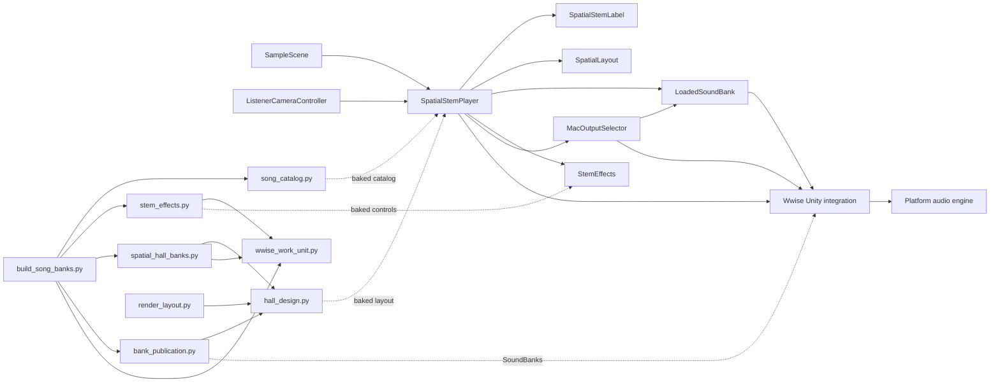

# Architecture, decisions and work queue

Upmix plays separated song stems as movable emitters in a Unity scene. The player can switch a whole song or a single stem, edit the mix, save a spatial layout, and apply a concert-hall preset with eight wet returns. The optional macOS output panel selects the device and plays a twelve-channel speaker check.

The governance branch starts at `25b4727` on `codex/spatial-layout-design`. That commit contains the Hall B feature on top of the main project snapshot `1f2cb03`. The separate stereo-spatializer prototype on the Copilot branch has no callers in this tree.

## Dependency map



MacOutputSelector compiles only in the macOS standalone player. The mixer, source map and hall partials share the SpatialStemPlayer component identity and its Unity lifecycle. First-party runtime types compile into Assembly-CSharp. The Editor smoke harness depends on that assembly. Vendor integration assemblies and generated native bindings follow the installed Wwise version.

## State ownership and change locations

| Change | Authority and consumers | Compatibility contract |
|---|---|---|
| Song availability, title, duration, harmony, bank/event naming | Edit `SONGS` in `song_catalog.py`, then run `python song_catalog.py`. The bank builder reads the entries directly. The generated player catalog supplies inspector and runtime labels. | Explicit enum ordinals in scenes, enum names in saved layouts, default bank with unsuffixed events. Source-folder titles can differ from display names. |
| Three-band EQ and two ordinary rooms | Edit `stem_effects.py`, then run `python stem_effects.py`. Its bindings supply the sliders, RTPC names and room bus selection. | The XML writer sets the Wwise filter types, ranges and curves. Runtime EQ uses the three components of a Vector3. |
| Hall stage, returns and bus identity | Edit `hall_design.py`, then run `python hall_design.py`. Runtime records include stage mute, world coordinates, stable return bus, layer and gain. The hall builder consumes the same return ordering. | Two early returns followed by six late returns. The design manifest and v1/v2 player layout JSON have distinct consumers and schemas. Rebuild documentation figures with `python docs/spatial-layout/render_layout.py`. |
| Playback and mix state | SpatialStemPlayer owns the live stem array. Each stem holds its emitter, song, playing ID, mix settings and event identity. The component stages replacements before committing them, and handles callback, seek, pause and pruning. | Only the original serialized stem fields belong to the scene. Per-song and per-track changes preserve their distinct timing rules. |
| Layout data and files | SpatialLayout owns the JSON fields, per-song filename, read and atomic replacement. SpatialStemPlayer resolves all entries against the catalog before preparing native resources. | v1 and v2 reads, v2 writes, fixed world coordinates and per-object song identity. Rejected imports preserve the live state. |
| UI and input | SpatialStemPlayer.Mixer owns IMGUI controls and selection. SourceMap owns marker projection, styles and reusable labels. ListenerCameraController reads input and toggles MixerOpen. SpatialStemLabel supplies scene labels. | Native work goes through playback commands or the macOS output panel. The layout selector and map read one legend. |
| Device and native resource lifetime | LoadedSoundBank distinguishes owned and borrowed loads. MacOutputSelector owns output selection, speaker-test bank, playing ID and callback. HallPreset owns return objects and the native send buffer. | Only the owner unloads a bank. Native sends use the SDK's element size and setters for eight entries. Ordinary room sends continue to use the integration array. |
| Inputs, cache and publication | build_song_banks.py owns CLI inputs, project preparation and the per-worktree build lock. wwise_work_unit.py owns stable UUIDs and effect slot structure. bank_publication.py validates and installs both platforms and preserves existing Unity metadata. | Two positional CLI arguments. Wwise exit codes 0 and 2 pass to fresh-output validation. Staging and rollback share the destination volume. |
| Configuration and diagnostics | ProjectSettings and Packages pin Unity configuration. Wwise binaries, source media and authoring project are device inputs. Runtime failures flow to switchError or Unity logging. CLI failures propagate the failing phase to the caller. | The application uses local files and native audio services. This tree contains no application login, remote service retry pipeline, hosted database or user credential store. |

## Decisions and migration progress

| Batch | Alternatives reviewed and decision |
|---|---|
| `89d2015`, `0a511e3` | Replaced duplicate inline effect-slot XML builders while retaining separate song/hall UUID prefixes. Property append and inherited-property replacement have different semantics. Kept both. Four fixture trees matched the original byte for byte. |
| `b3ab74f`, `f7b0d18`, `4101376`, `d0ee488` | Compared loading design files on startup with baking typed C# data. Selected baking to preserve Unity serialization, startup behavior and the existing authoring CLI. The Python definitions own edits. CI detects stale projections. |
| `cb90610`, `b5e07eb`, `3d7418d` | Moved persistence out of IMGUI and validated layout entries before allocation. Kept the v1/v2 fields. Removed the parallel playing-ID array and migrated callbacks, track replacement, append, removal and teardown to stem-owned IDs. |
| `70b8990`, `94b64d3`, `dc802f3`, `c649bf4` | Removed whole-song iteration from the single-track path, shared synchronized posting, and consolidated map projection. Kept the scene component and IMGUI to avoid a framework or asset migration. Native device commands now live in the platform module. |
| `18a2abc` | Replaced three implementations of load-result interpretation with one disposable bank handle. The smoke test exercises acquired, borrowed and released states against the real engine. |
| `bcb747e`, `fe3b807` | Preserved the cached project path for local authoring tools. An OS lock serializes writers. A run invalidates expected cached banks and stages new bytes before replacement. A recoverable install failure rolls back. If the rollback itself lacks access, the error identifies the recovery directory containing the previous files. |
| `9dd4f5b` and the compiled dependency check | The Python test suite runs on Windows and Linux. It covers module imports, selected C# call boundaries and data projections. The local PowerShell verifier inspects compiled player IL for first-party cycles, including target-specific code. |

## Validation and handoff

1. Run `python -B -m unittest discover -s tests` from the repository root. The suite exercises the shared authoring contract, metadata preservation, stale output, lock contention and rollback. Regenerate edited data definitions before committing them with their projections.
2. Provision the exact Editor, Wwise binaries and media described in HANDOFF.md. Generate the two platform bank sets with the normal CLI. The final Windows development-machine check compared all 20 output files, totaling 5,751,173,364 bytes, with the previous playable checkout using SHA-256.
3. Run the Unity Editor with `-batchmode -nographics -wwiseEnableWithNoGraphics -runTests -testPlatform EditMode -testFilter HallPresetSmoke -projectPath <WwiseUpmix> -testResults <xml>`. Require one passed test. The harness exercises native ownership, eight spatial sends, bypass, disk create/replace/read, invalid import rollback, paused track and song switches, append/remove and legacy restore.
4. Compile the Windows and macOS standalone players. Run the following once against each built player's managed Assembly-CSharp.dll. The verifier groups nested types with their owning component and checks references in base types, interfaces, fields, signatures, locals and method instructions. A deliberately injected reverse edge was rejected during validation.

```powershell
./tools/check_player_dependencies.ps1 -AssemblyPath <player-assembly> -EditorPath <Unity.exe>
```

## Task pool and verification limits

| Status | Item and trigger |
|---|---|
| Closed | Song, effect and hall definitions, file schema ownership, Wwise load ownership, live stem identity, mixer/native boundary, bank validation and interrupted-install recovery. Regression coverage is listed above. |
| Device validation | Test physical macOS output selection, twelve-channel speaker assignment and perceived spatial balance with the target interface. A successful macOS cross-build verifies compilation and packaging. The Windows native smoke measures registered sends and transport behavior. |
| Product decision | Changes to the hall voicing, source availability, layout schema or fallback device policy need explicit product direction. Current bank hashes and save contracts are the baseline. |
| Operational recovery | On abrupt process or machine loss during multi-file replacement, rerun the CLI after restoring filesystem access. Individual replacements are atomic. If an exceptional rollback reports a recovery directory, retain it until the original files or regenerated set have been verified. |
