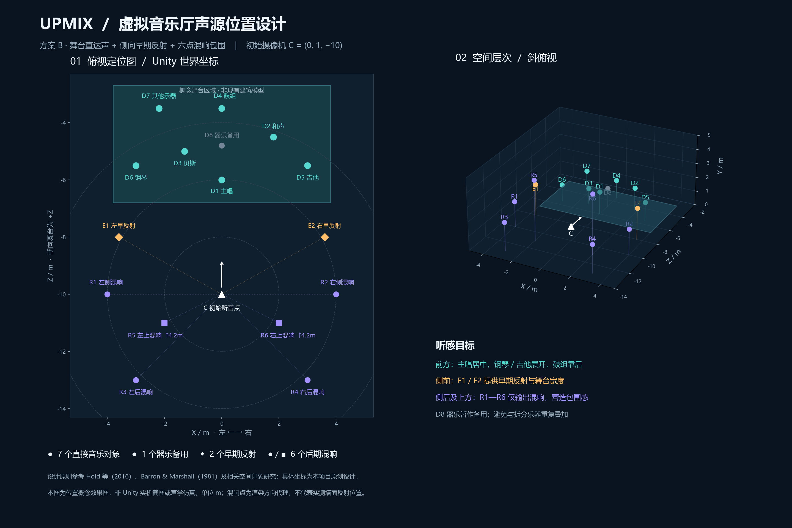

# 虚拟音乐厅声源位置方案 B

2026-11-28 · 位置设计阶段。未修改 Unity 场景、播放代码或 SoundBank，未进行听音验证。

## 项目依据

`WwiseUpmix/Assets/Scenes/SampleScene.unity` 的 Main Camera 世界坐标为 `(0,1,-10)`，旋转为单位四元数，无父对象，朝向 +Z。Spatial Stems 根对象无位移、旋转，因此现有分轨局部坐标等于世界坐标。约定1 Unity单位为1m。图中舞台是概念区域，不是已有建筑模型或红馆复刻。

场景、播放器及本地音频具有 Vocal、Harmony、Bass、Drums、Guitar、Piano、Other、Instrumental 八类。文件类别不等于歌曲中确有该乐器：可能存在静音、串音或错误分类，本次未逐曲试听。Other 不进一步虚构为弦乐或铜管；Instrumental 先保留为备用，核实是否整份伴奏或独立残余后再启用，避免与其他乐器重复叠加。

播放器对《致爱丽丝》《香山射鼓》跳过 Harmony 事件。古典独奏应根据试听集中真实主奏，并关闭无效类别，不能因为分轨文件名而营造虚假的七人乐队。本图以《我不难过》等流行/乐队曲目为基础。

## 文献依据与推导边界

依据用户提供的“查找虚拟音乐厅文献”对话，重新核对了以下论文页面或摘要。所有具体坐标、点数与调参范围都是本项目设计假设，不是论文测得的最优值。

- Hold、Nagel、Wierstorf、Raake（2016）：[Positioning of Musical Foreground Parts in Surrounding Sound Stages](https://aes.org/publications/elibrary/elibrary-page/?id=18505)。摘要研究对象空间分布及前景音乐与偏好的关系。主唱稳定在前、伴奏舞台展开是本方案的待验证选择，摘要并未证明唯一最优摆位。
- Barron、Marshall（1981）：[Spatial Impression Due to Early Lateral Reflections in Concert Halls](https://doi.org/10.1016/S0022-460X(81)80020-X)。研究反射延时、方向、电平、频谱及早期侧向能量与空间印象的关系，支持单独设置侧向早反射层。
- 原对话提及 Bradley / Soulodre 的晚期能量研究；本次可访问的研究论文 [The effect of diffuse reflections on spatial discrimination in a simulated concert hall](https://pubs.aip.org/asa/jasa/article/133/5/EL370/610023/The-effect-of-diffuse-reflections-on-spatial)（2013）也区分声源宽度与主要受晚期反射影响的包围感。用于支持直达声和晚期混响分层。顶部两点是本方案的高度补充，不声称顶部比侧向能量更有效。
- Estakhrian、Abel（2022）：[Production Approaches, Loudspeaker Configurations, and Signal Processing Architectures for Live Virtual Acoustic Performance](https://aes.org/publications/elibrary-page/?id=21719)。核对到条目，保留作后续架构阅读来源；本次不依据未读取的全文推导参数。

红馆工程资料仅作背景，没有将实体PA坐标直接当成音乐对象位置，也未获得红馆实测反射路径。

## 坐标表

全部为 Unity 世界 `(X,Y,Z)`、单位m；Y向上，−X为听众左侧，+Z朝向舞台。相对初始相机坐标为 `(X,Y−1,Z+10)`，同时存入 JSON。

| ID | 对象 | 原世界坐标 | 建议世界坐标 | 用途 |
| --- | --- | --- | --- | --- |
| D1 | 主唱 Vocal | (0,1,−7) | (0,1.6,−6) | 前中，距听众前方4m |
| D2 | 和声 Harmony | (1,2,−13) | (1.8,1.6,−4.5) | 移回舞台右后方 |
| D3 | 贝斯 Bass | (−1,1,−7) | (−1.3,1.1,−5) | 中轴左侧 |
| D4 | 鼓组 Drums | (0,1,−5) | (0,1.3,−3.5) | 舞台中后方 |
| D5 | 吉他 Guitar | (3,1,−9) | (3,1.3,−5.5) | 右侧约34° |
| D6 | 钢琴 Piano | (−3,1,−9) | (−3,1.2,−5.5) | 左侧约34° |
| D7 | 其他乐器 Other | (−2,2,−12) | (−2.2,1.5,−3.5) | 后排左侧，待试听内容 |
| D8 | 器乐 Instrumental | (2,2,−12) | (0,1.3,−4.8) | 默认备用 |
| E1 | 左侧早期反射 | 新增设计 | (−3.6,2.2,−8) | 左前约61° |
| E2 | 右侧早期反射 | 新增设计 | (3.6,2.2,−8) | 右前约61° |
| R1 | 左侧晚期混响 | 新增设计 | (−4,1.8,−10) | 左90° |
| R2 | 右侧晚期混响 | 新增设计 | (4,1.8,−10) | 右90° |
| R3 | 左后晚期混响 | 新增设计 | (−3,2,−13) | 左135° |
| R4 | 右后晚期混响 | 新增设计 | (3,2,−13) | 右135° |
| R5 | 左上晚期混响 | 新增设计 | (−2,4.2,−11) | 左117°、仰角约55° |
| R6 | 右上晚期混响 | 新增设计 | (2,4.2,−11) | 右117°、仰角约55° |

后续加入可见演奏者时，音源应与人物/乐器对齐。当前小地图默认半径6m会遗漏部分后排对象，实施时建议至少8m。

## 混响信号与实施要求

E/R点是合成反射和混响的方向代理，不是真实墙面或精确镜像声源。以初始摄像机为中心设计，但固定在世界空间，不挂到 Camera 下、不随转头旋转。大范围移动需进一步设计区域过渡，本次针对初始听音区。

R1—R6 仅输出纯湿声，不能在周围复制播放原始分轨。E1/E2 仅输出延时和频谱处理后的反射分量。晚期六路应采用不同、低相关的扩散输出；不能将同一单声道 wet 完全同相复制六次。控制总返回能量，避免仅因点数增加而更响。

后续试听起点（非实测、非论文参数）：在初始听音点，以同一测试乐段整体干声RMS为参考，早反射每路从约−18dB、总晚期返回从约−16dB开始，顶部低于侧后方。先匹配响度再比较。这不是可直接填入Wwise的物体音量，需要按发送、衰减、滤波和效果增益校准。

可试相对直达声25–45ms的早反射、80–120ms后开始的扩散尾声及1.2–1.8s衰减目标，再按节奏、人声清晰度、录音已有混响调整。代理点距离不自动产生这些延时，也不代表真实反射路程。早反射与尾声应平滑衔接；先用脉冲测量实际到达时间，避免重复计入传播延时。

当前 `SpatialStemPlayer.ApplyMix()` 向 `StemSmallRoom` 或 `StemHall` 发送，默认roomSend=0.12；`build_song_banks.py` 创建RoomVerb AuxBus并压低dry。现有逻辑没有这八个空间返回对象。新增空GameObject或复制分轨不能自动实现方案，需要设计空间化wet返回路径，或离线生成同步湿声分轨，并核对输出格式。引入新返回前先旁路原Hall返回，避免重复混响。

实施后验证：在C点等响比较仅干声、加早反射、完整方案；独听每个返回确认无重复直达声；检查静音/暂停/跳转同步。转头90°/180°、四向移动1m时，舞台应保持世界位置且没有突兀热点。耳机双耳和7.1.4音箱需分别验证，本图不是物理音箱摆位图，未验证HRTF或声道映射。

## 文件和跨设备交接

- `spatial-layout-overview.png`：2880×1920位置效果图；SVG为矢量版。
- `layout-design.json`：原坐标、建议坐标及相对相机坐标；是设计清单，**不是播放器的运行时导入格式**。
- `render_layout.py`：仓库根目录执行 `python docs/spatial-layout/render_layout.py` 重建图片及JSON。依赖Python、matplotlib、NumPy；中文字体优先Microsoft YaHei，其他系统需选择可用中文字体。

另一设备fetch后检出 `codex/spatial-layout-design` 并pull --ff-only。查看交付物无需Unity或原始音频；音频按根目录HANDOFF.md单独获取。本次核对了场景坐标、图表和清单一致性及图片可读性，未做运行时音频或声学验证。
